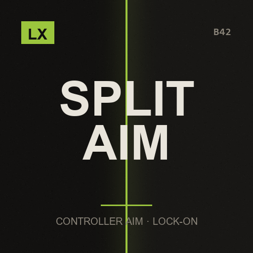

# LX Split Aim

**Controller aim that works, for every local player**

> B42 made shooting with a gamepad nearly impossible. This gives it back — for all 4 split-screen players at once.

`Project Zomboid B42.21+` · `v1.0.0` · `MIT`

[English](#english) · [Español](#español) · [Русский](#русский)

---

## English

This mod is part of the **LX Split-Screen Suite**, seven mods that make Project Zomboid B42 playable in 2–4 player couch co-op, with or without a gamepad. Each one stands alone — install only what you need.

### Why split-screen?

Split-screen is the mode that carries the most bugs in stable B42 — and the mods worth playing with, like Bandits and Project A-Life, are built for singleplayer and online multiplayer. Nobody is fixing couch co-op. This suite exists to close that gap: to make split-screen as playable as the modes that get the attention.

### Why gamepad?

B42 keeps improving controller support, but it is still rough, and the aim-and-shoot rework left gunplay on a gamepad close to unusable — you cannot even shoot a zombie lying on the ground. Split-screen *with* a gamepad is the worst case the game offers. These mods give PZ back an aim that was designed for a stick: assist on the vertical axis, B41-style lock-on, per-player aim state, and a lot more.

### What it does

- **Shoot zombies on the ground** — B42's controller aim cannot resolve height: a zombie lying on the floor, crawling, or one level up or down is effectively unshootable. Lock-on solves the vertical axis for you — push the right stick toward a zombie and the reticle goes to its body, whatever height it is at.
- **Every player gets their own aim** — The mod this forks kept aim state in global flags, so in split-screen one player kept overwriting the other's. Here the state is per player index, so four people can aim at once without interfering.
- **B41-style lock-on** — A configurable cone picks the zombie closest to where you are pushing the stick, and the reticle snaps and then tracks it as it moves. Optional head targeting. Optional on-screen brackets on the locked target, drawn in that player's own viewport.
- **Soft-snap when nothing is locked** — Separate horizontal, vertical and head strengths, hitbox zone sizes, pull-up easing to reach the head, recenter resistance and a stick response curve — all adjustable, so you can tune it from “barely there” to “very sticky”.
- **Stays out of the way** — Aim assist switches off automatically while that player has a radial menu, inventory, map or any UI holding their controller — and for the keyboard-and-mouse player.

### Requirements

| Mod | Workshop | |
|---|---|---|
| ZombieBuddy | [3619862853](https://steamcommunity.com/sharedfiles/filedetails/?id=3619862853) | required |

**Load order:** load this **after** `ZombieBuddy`. `mod.info` already declares it.

**Incompatible:** [Controller Aim Assist (B42)](https://steamcommunity.com/sharedfiles/filedetails/?id=3731886676)

### Installing

**From the Steam Workshop (recommended)**
Subscribe on the Workshop page. Steam downloads it; then start Project Zomboid, go to
**Mods** in the main menu and enable it. In split-screen, enabling it once covers all players.

**Manually**
1. Download this repository (green **Code** button -> **Download ZIP**) and unzip it.
2. Copy the folder `LX_SplitAim` into your Zomboid mods folder:
   - Windows: `C:\Users\<you>\Zomboid\mods\`
   - Linux: `~/Zomboid/mods/`
   - macOS: `~/Library/Application Support/Zomboid/mods/`
   The result must be `...\Zomboid\mods\LX_SplitAim\42\mod.info`.
3. Start the game, open **Mods** in the main menu and enable **LX Split Aim**.

### Options

Options → MODS → **LX Split Aim**. Master switch, lock-on (cone, speed, floors up/down, head targeting, marker), soft-snap strengths, hitbox zones, recenter resistance and stick curve.

### Notes

- Vanilla B42 still requires holding the aim trigger to aim. This mod does not change that — it changes where the reticle goes once you are aiming.
- Do **not** enable this together with the original Controller Aim Assist (B42). They patch the same thing; `mod.info` marks them incompatible.
- Needs [ZombieBuddy](https://steamcommunity.com/sharedfiles/filedetails/?id=3619862853) 2.3.0+.

### Credits

Fork of [Controller Aim Assist (B42)](https://steamcommunity.com/sharedfiles/filedetails/?id=3731886676) by *Here to Suffer not for Fun* (wenbo), used and redistributed under the MIT License. Split-screen rework and B41-style lock-on by LX. The original license and copyright notice are kept in `LICENSE`.

### License

**MIT** — inherited from the mod this forks, and kept as required. Free for any use, including commercial, as long as the copyright notice travels with it. See `LICENSE`.

### The rest of the suite

- [LX Coop Fixes](https://github.com/litoxperaloca/LX_CoopFixes) — Split-screen stability: vehicle crash, player 2 aiming, map stutter, error spam.
- [LX Split-Screen Quick Build](https://github.com/litoxperaloca/LX_SPLITSCREEN_CONTEXTMENU_BUILDING) — B41-style build menu in the context menu, because B42's window does not fit.
- [LX A-Life Split-Screen Fix](https://github.com/litoxperaloca/LX_ALifeSplit) — Project A-Life NPCs react to every local player, not just player 1.
- [LX Bandits Split-Screen Fix](https://github.com/litoxperaloca/LX_BanditsSplit) — Bandits target the right player, companions follow who recruited them.
- [LX Split-Screen Welcome Package](https://github.com/litoxperaloca/LX_SPLITSCREEN_WELCOME_PACKAGE) — A configurable starter kit per local character.
- [LX Split-Screen Skills Boost](https://github.com/litoxperaloca/LX_SPLITSCREEN_SKILLS_IMPROVE) — A configurable skill floor per local character.

---

## Español

> La B42 dejó el disparo con mando casi imposible. Esto se lo devuelve — para los 4 jugadores en pantalla dividida a la vez.

Este mod es parte de la **LX Split-Screen Suite**, siete mods que hacen jugable Project Zomboid B42 en coop de sillón de 2 a 4 jugadores, con o sin mando. Cada uno funciona por separado — instalá solo lo que precises.

### ¿Por qué pantalla dividida?

Es la modalidad con más bugs en la B42 estable — y los mods que valen la pena, como Bandits y Project A-Life, están pensados para un jugador y multijugador online. Nadie arregla el coop de sillón. Esta suite existe para cerrar esa brecha: dejar la pantalla dividida a la par de las modalidades que sí reciben atención.

### ¿Por qué mando?

La B42 viene mejorando el soporte de mando, pero todavía deja mucho que desear, y el rework de apuntado y disparo dejó el tiroteo con mando casi imposible — ni siquiera podés dispararle a un zombi en el suelo. Pantalla dividida *con* mando es el peor escenario posible del juego. Estos mods le devuelven a PZ un apuntado pensado para stick: asistencia en el eje vertical, fijado de blanco estilo B41, estado de apuntado por jugador, y bastante más.

### Qué hace

- **Dispararle a zombis en el suelo** — El apuntado con mando de B42 no resuelve la altura: un zombi tirado en el piso, arrastrándose, o un piso más arriba o abajo es prácticamente imposible de acertar. El fijado de blanco te resuelve el eje vertical — empujás el stick derecho hacia un zombi y el retículo va a su cuerpo, esté a la altura que esté.
- **Cada jugador tiene su propio apuntado** — El mod del que esto es fork guardaba el estado de apuntado en variables globales, así que en pantalla dividida un jugador le pisaba el estado al otro. Acá el estado es por índice de jugador, así que cuatro personas pueden apuntar a la vez sin interferirse.
- **Fijado de blanco estilo B41** — Un cono configurable elige el zombi más cercano a donde empujás el stick, y el retículo salta y después lo sigue mientras se mueve. Apuntado a la cabeza opcional. Marcador en pantalla opcional sobre el blanco fijado, dibujado en el viewport de ese jugador.
- **Asistencia suave cuando no hay blanco fijado** — Fuerza horizontal, vertical y de cabeza por separado, tamaño de las zonas de impacto, suavizado al tirar hacia arriba para llegar a la cabeza, resistencia al recentrado y curva de respuesta del stick — todo ajustable, así que lo podés calibrar desde “apenas se nota” hasta “muy pegajoso”.
- **No molesta** — La asistencia se apaga sola mientras ese jugador tiene abierto un menú radial, el inventario, el mapa o cualquier UI que le tome el mando — y para el jugador de teclado y mouse.

### Requisitos

| Mod | Workshop | |
|---|---|---|
| ZombieBuddy | [3619862853](https://steamcommunity.com/sharedfiles/filedetails/?id=3619862853) | obligatorio |

**Orden de carga:** cargá este **después** de `ZombieBuddy`. El `mod.info` ya lo declara.

**Incompatible:** [Controller Aim Assist (B42)](https://steamcommunity.com/sharedfiles/filedetails/?id=3731886676)

### Instalación

**Desde el Steam Workshop (recomendado)**
Suscribite en la página del Workshop. Steam lo descarga solo; después abrí Project Zomboid,
andá a **Mods** en el menú principal y activalo. En pantalla dividida, con activarlo una vez
alcanza para todos los jugadores.

**A mano**
1. Descargá este repositorio (botón verde **Code** -> **Download ZIP**) y descomprimilo.
2. Copiá la carpeta `LX_SplitAim` a tu carpeta de mods de Zomboid:
   - Windows: `C:\Users\<vos>\Zomboid\mods\`
   - Linux: `~/Zomboid/mods/`
   - macOS: `~/Library/Application Support/Zomboid/mods/`
   Tiene que quedar `...\Zomboid\mods\LX_SplitAim\42\mod.info`.
3. Abrí el juego, entrá a **Mods** en el menú principal y activá **LX Split Aim**.

### Opciones

Opciones → MODS → **LX Split Aim**. Interruptor general, fijado de blanco (cono, velocidad, pisos arriba/abajo, apuntar a la cabeza, marcador), fuerzas de asistencia suave, zonas de impacto, resistencia al recentrado y curva del stick.

### Notas

- La B42 vanilla sigue pidiendo mantener el gatillo de apuntar. Este mod no cambia eso — cambia a dónde va el retículo una vez que estás apuntando.
- **No** lo actives junto con el Controller Aim Assist (B42) original. Parchean lo mismo; el `mod.info` los marca incompatibles.
- Necesita [ZombieBuddy](https://steamcommunity.com/sharedfiles/filedetails/?id=3619862853) 2.3.0+.

### Créditos

Fork de [Controller Aim Assist (B42)](https://steamcommunity.com/sharedfiles/filedetails/?id=3731886676) de *Here to Suffer not for Fun* (wenbo), usado y redistribuido bajo licencia MIT. Rework para pantalla dividida y fijado estilo B41 por LX. La licencia y el aviso de copyright originales se conservan en `LICENSE`.

### Licencia

**MIT** — heredada del mod del que es fork, y conservada como corresponde. Libre para cualquier uso, incluso comercial, mientras el aviso de copyright viaje con el código. Ver `LICENSE`.

### El resto de la suite

- [LX Coop Fixes](https://github.com/litoxperaloca/LX_CoopFixes) — Estabilidad en pantalla dividida: crash de vehículos, apuntado del jugador 2, tirones del mapa, spam de errores.
- [LX Split-Screen Quick Build](https://github.com/litoxperaloca/LX_SPLITSCREEN_CONTEXTMENU_BUILDING) — Menú de construcción estilo B41 en el menú contextual, porque la ventana de B42 no entra.
- [LX A-Life Split-Screen Fix](https://github.com/litoxperaloca/LX_ALifeSplit) — Los NPCs de Project A-Life reaccionan a todos los jugadores locales, no solo al 1.
- [LX Bandits Split-Screen Fix](https://github.com/litoxperaloca/LX_BanditsSplit) — Los bandidos apuntan al jugador correcto, los compañeros siguen a quien los reclutó.
- [LX Split-Screen Welcome Package](https://github.com/litoxperaloca/LX_SPLITSCREEN_WELCOME_PACKAGE) — Un equipo inicial configurable por personaje local.
- [LX Split-Screen Skills Boost](https://github.com/litoxperaloca/LX_SPLITSCREEN_SKILLS_IMPROVE) — Un piso de habilidades configurable por personaje local.

---

## Русский

> B42 сделала стрельбу с геймпада почти невозможной. Это возвращает её — сразу для всех 4 игроков на разделённом экране.

Этот мод входит в набор **LX Split-Screen Suite** — семь модов, которые делают Project Zomboid B42 играбельным в совместной игре на диване для 2–4 человек, с геймпадом или без. Каждый работает сам по себе — ставьте только нужное.

### Почему разделённый экран?

Разделённый экран — режим с наибольшим числом ошибок в стабильной B42, а моды, ради которых стоит играть, вроде Bandits и Project A-Life, сделаны под одиночную игру и сетевой мультиплеер. Совместной игрой на диване не занимается никто. Этот набор существует, чтобы закрыть пробел: сделать разделённый экран таким же играбельным, как режимы, которым достаётся внимание.

### Почему геймпад?

B42 продолжает улучшать поддержку контроллеров, но она всё ещё сырая, а переработка прицеливания и стрельбы сделала перестрелки с геймпада почти невозможными — вы даже не можете выстрелить в зомби, лежащего на полу. Разделённый экран *вместе* с геймпадом — худший случай, который предлагает игра. Эти моды возвращают PZ прицеливание, рассчитанное на стик: помощь по вертикальной оси, захват цели в стиле B41, отдельное состояние прицеливания для каждого игрока и многое другое.

### Что делает

- **Стрелять по зомби на полу** — Прицеливание с геймпада в B42 не умеет решать вопрос высоты: в зомби, лежащего на полу, ползущего или этажом выше либо ниже, фактически невозможно попасть. Захват цели решает вертикальную ось за вас — наклоните правый стик в сторону зомби, и прицел встанет на его тело, на какой бы высоте оно ни было.
- **У каждого игрока своё прицеливание** — Мод, форком которого это является, хранил состояние прицеливания в глобальных переменных, поэтому при разделённом экране один игрок постоянно затирал состояние другого. Здесь состояние хранится по индексу игрока, так что четверо могут целиться одновременно, не мешая друг другу.
- **Захват цели в стиле B41** — Настраиваемый конус выбирает зомби, ближайшего к направлению стика, прицел переходит на него и затем сопровождает при движении. Опционально — прицеливание в голову. Опционально — уголки на захваченной цели, нарисованные в собственной области экрана каждого игрока.
- **Мягкий довод, когда захвата нет** — Отдельные силы по горизонтали, вертикали и голове, размеры зон попадания, смягчение при ведении вверх для выхода на голову, сопротивление возврату в центр и кривая отклика стика — всё настраивается, от «почти незаметно» до «очень липко».
- **Не мешает** — Помощь прицеливания автоматически отключается, пока у этого игрока открыто радиальное меню, инвентарь, карта или любой интерфейс, забравший его геймпад — и для игрока с клавиатурой и мышью.

### Требования

| Mod | Workshop | |
|---|---|---|
| ZombieBuddy | [3619862853](https://steamcommunity.com/sharedfiles/filedetails/?id=3619862853) | обязательно |

**Порядок загрузки:** загружайте этот мод **после** `ZombieBuddy`. `mod.info` уже это объявляет.

**Несовместимо с:** [Controller Aim Assist (B42)](https://steamcommunity.com/sharedfiles/filedetails/?id=3731886676)

### Установка

**Из Steam Workshop (рекомендуется)**
Подпишитесь на странице Workshop. Steam скачает мод сам; затем запустите Project Zomboid,
откройте **Моды** в главном меню и включите его. При разделённом экране достаточно включить
один раз — это работает для всех игроков.

**Вручную**
1. Скачайте этот репозиторий (зелёная кнопка **Code** -> **Download ZIP**) и распакуйте.
2. Скопируйте папку `LX_SplitAim` в папку модов Zomboid:
   - Windows: `C:\Users\<вы>\Zomboid\mods\`
   - Linux: `~/Zomboid/mods/`
   - macOS: `~/Library/Application Support/Zomboid/mods/`
   Должно получиться `...\Zomboid\mods\LX_SplitAim\42\mod.info`.
3. Запустите игру, откройте **Моды** в главном меню и включите **LX Split Aim**.

### Настройки

Настройки → МОДЫ → **LX Split Aim**. Главный переключатель, захват цели (угол, скорость, этажи вверх и вниз, прицеливание в голову, маркер), силы мягкого довода, зоны попадания, сопротивление возврату в центр и кривая стика.

### Примечания

- Обычная B42 по-прежнему требует удерживать курок прицеливания. Этот мод этого не меняет — он меняет то, куда идёт прицел, когда вы уже целитесь.
- **Не** включайте его вместе с оригинальным Controller Aim Assist (B42). Они патчат одно и то же; `mod.info` помечает их несовместимыми.
- Требуется ZombieBuddy 2.3.0+.

### Благодарности

Форк Controller Aim Assist (B42) от *Here to Suffer not for Fun* (wenbo), используется и распространяется по лицензии MIT. Переработка под разделённый экран и захват цели в стиле B41 — LX. Исходная лицензия и уведомление об авторских правах сохранены в `LICENSE`.

### Лицензия

**MIT** — унаследована от мода, форком которого это является, и сохранена как требуется. Свободно для любого использования, включая коммерческое, при условии что уведомление об авторских правах остаётся с кодом. См. `LICENSE`.

### Остальные моды набора

- [LX Coop Fixes](https://github.com/litoxperaloca/LX_CoopFixes) — Стабильность разделённого экрана: вылет транспорта, прицеливание второго игрока, подтормаживания карты.
- [LX Split-Screen Quick Build](https://github.com/litoxperaloca/LX_SPLITSCREEN_CONTEXTMENU_BUILDING) — Меню строительства в стиле B41 в контекстном меню, потому что окно B42 не помещается.
- [LX A-Life Split-Screen Fix](https://github.com/litoxperaloca/LX_ALifeSplit) — NPC из Project A-Life реагируют на всех локальных игроков, а не только на первого.
- [LX Bandits Split-Screen Fix](https://github.com/litoxperaloca/LX_BanditsSplit) — Бандиты целятся в нужного игрока, напарники следуют за тем, кто их нанял.
- [LX Split-Screen Welcome Package](https://github.com/litoxperaloca/LX_SPLITSCREEN_WELCOME_PACKAGE) — Настраиваемый стартовый набор для каждого локального персонажа.
- [LX Split-Screen Skills Boost](https://github.com/litoxperaloca/LX_SPLITSCREEN_SKILLS_IMPROVE) — Настраиваемый минимальный уровень навыков для каждого локального персонажа.

